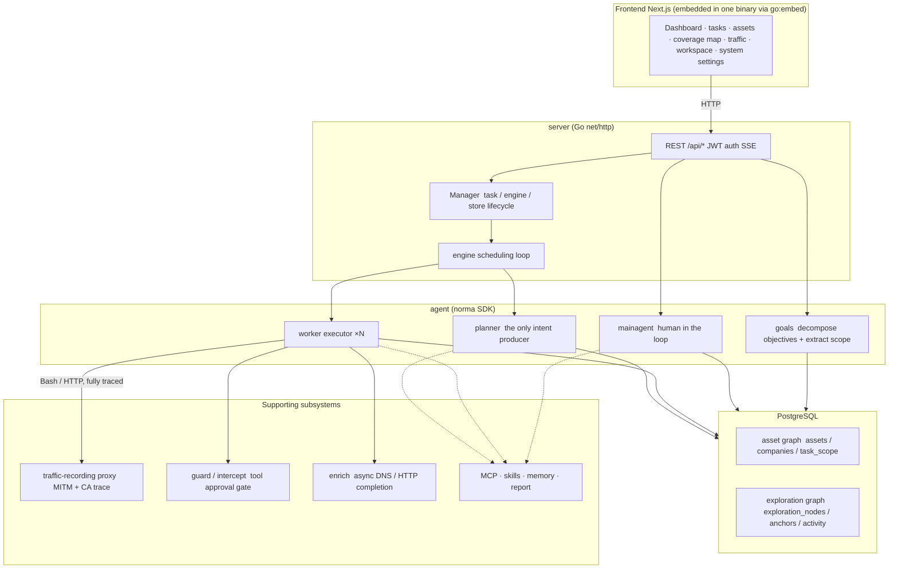
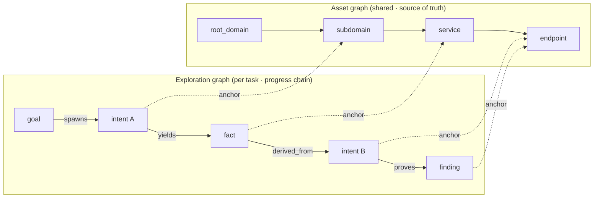
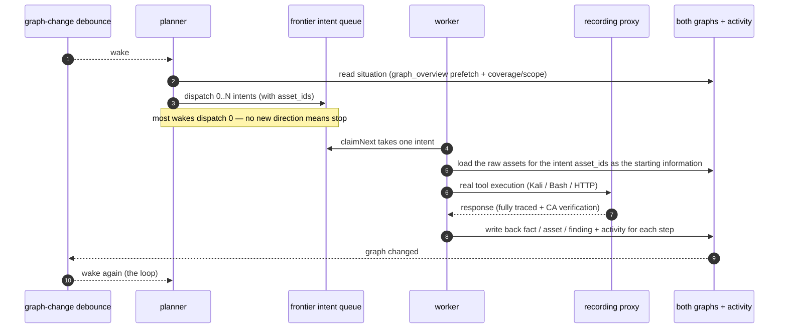
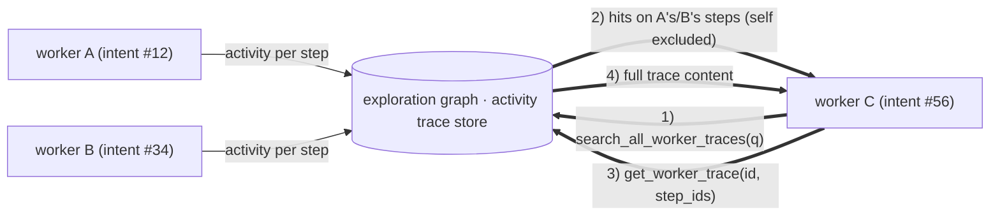
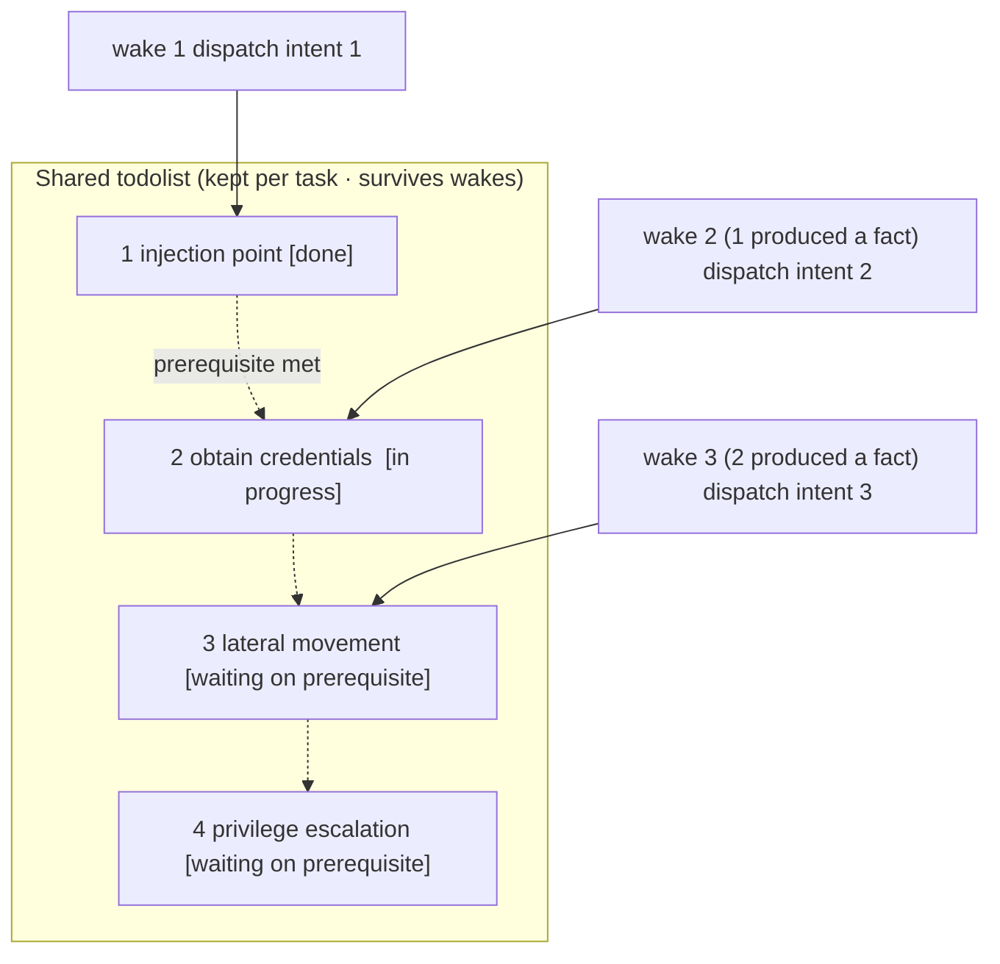

<div align="center">

# ARTEX

English fork of the autonomous AI penetration-testing system (Go backend + Next.js frontend).

This tree is [S3lrius/ARTEX](https://github.com/S3lrius/ARTEX). It is a fork of the original project, not a mirror of it. The priorities here are different:

- The interface, prompts, comments, and docs are English.
- You build and run this source. Compose does not pull a published ARTEX image.
- There is no in-app updater. To move to a newer build, pull this repository and rebuild.

The original project is [Autumn-27/ARTEX](https://github.com/Autumn-27/ARTEX). Its simulated demo is [artex-demo.mhtsec.com](https://artex-demo.mhtsec.com). That demo, and any image published for the original project, is not how this fork is installed.

</div>

---

## Screenshots

> The screenshots below are from the original project. This fork's interface is the English translation of that UI.

| Dashboard (overview / token usage / activity stream) | Task list |
| :---: | :---: |
|  |  |

| Task · execution (sessions / tool calls) | Exploration graph |
| :---: | :---: |
|  |  |

| Findings | Assets |
| :---: | :---: |
|  |  |

| Asset coverage map (force-directed layout · tested nodes highlighted · collapse and expand) |
| :---: |
|  |

| Traffic recording | Human-in-the-loop chat |
| :---: | :---: |
|  |  |

| Agent management | LLM configuration |
| :---: | :---: |
|  |  |

| Intercept approval | Backend logs |
| :---: | :---: |
|  |  |


---

## Approval record detail

The global "Approval records" view, the in-task "Intercept approval" view, and approval cards in chat can all expand to show detail. The layout follows
[AegisHook's approval detail component](https://github.com/RuoJi6/AegisHook/blob/main/web/src/components/CallDetail.vue), using ARTEX components and theme:


## Asset sync (ScopeSentry)

Assets can be synced directly from [ScopeSentry](https://github.com/Autumn-27/ScopeSentry), so they do not have to be collected again:

- On the "**Asset sync**" page, enter the ScopeSentry address and API key to connect the source;
- Choose targets and asset types by **project** or **task** (domain / subdomain / IP / port / site / endpoint…);
- Import in one step and merge them into the company asset scope. They land in the ARTEX asset graph for the agent to explore.

---

## Install

> Requires **PostgreSQL**. Exploration needs an **LLM** (`ANTHROPIC_API_KEY` or `OPENAI_API_KEY`, or set it in the UI).

### Method 1: One-command install script (recommended)

```bash
git clone https://github.com/S3lrius/ARTEX.git
cd ARTEX
./install.sh
```

The script requires Docker to already be installed, then asks you to choose **① all Docker** or **② local build and run**:

- **① All Docker**: enter a Postgres password (Enter for a random one) → writes `.env` → builds the ARTEX image from this source → `docker compose up -d`. Postgres is the only image that is pulled (`postgres:16-alpine`).
- **② Local run**: choose a database (connect to an existing one, or start one with Docker) → writes `config.json` → `go` builds a single binary with the frontend embedded → starts it.

Then open **http://localhost:8787** (the first visit to `/setup` sets the administrator password).

### Method 2: Docker Compose (manual)

```bash
git clone https://github.com/S3lrius/ARTEX.git
cd ARTEX
cp .env.example .env          # set POSTGRES_PASSWORD and optional ANTHROPIC_API_KEY
docker compose up -d --build  # build ARTEX from this source; pull postgres:16-alpine
# → http://localhost:8787
```

> There is no ARTEX image to pull. `docker compose up` builds the `artex` service from the Dockerfile in this repository.
> The Dockerfile is multi-stage (frontend static export → static Go build → runtime image). Module downloads use the public Go and npm registries. If you need a mirror, pass `--build-arg GOPROXY=...` and `--build-arg NPM_REGISTRY=...`.

The image already includes common tools (ripgrep/curl/vim/npm/nmap…). `./skills` and `./data` are bind-mounted so they persist.

Remote MCP can be set to `http` (Streamable HTTP) or `sse` (legacy SSE) in system settings.
Legacy SSE servers usually open the event stream with `GET /sse`, then accept JSON-RPC on the
`/message?sessionId=...` URL the server returns. Set the URL to `/sse` and the header to
`Authorization=Bearer <token>`.

### Method 3: Download a prebuilt binary (Releases)

Download the zip for your platform from this fork's [Releases](https://github.com/S3lrius/ARTEX/releases) (**binaries exist only after a version tag is published here**; otherwise use method 2 or method 4). Unzip to get `artex` + `start.sh` (`start.bat` on Windows) + `skills/` + `config.example.json`:

```bash
cp config.example.json config.json   # fill in the database connection
./start.sh                           # → http://localhost:8787
```

> Start with `start.sh` / `start.bat`, not by running `./artex` directly. It is a supervisor: after a crash it starts the process again, and under Docker it forwards stop signals to the program.
> Background: `nohup ./start.sh >artex.log 2>&1 &`.

### Method 4: Build a single binary from source

```bash
# 1) Frontend static export
cd web && npm ci && npm run build:static && cd ..
# 2) Copy it into the embed directory
cp -r web/out server/webui/dist
# 3) Build (-tags embedui embeds the frontend)
CGO_ENABLED=0 go build -tags embedui -o artex ./cmd/artex
./start.sh
```

### Method 5: Build cross-platform release archives

`build.sh` builds and embeds the frontend, strips debug info with the Go linker, and zips the release files. Release mode writes zips for Linux amd64/arm64, macOS amd64/arm64, and Windows amd64 by default:

```bash
./build.sh --release
# output: dist/artex-0.3.3-*.zip
```

UPX self-extracting binaries can be incompatible with some Linux kernels, virtualization, or security policies, so UPX is off by default. Override targets with `ARTEX_TARGETS`. When you know the target environment can run UPX, pass `--upx` to shrink the binary further:

```bash
ARTEX_TARGETS=linux/amd64,windows/amd64 ./build.sh --release
./build.sh --target linux/amd64 --upx
```

---

## Upgrade

> An upgrade replaces the program and leaves data in place: the Postgres volume `pgdata`, `./data` (jwt.key / SQLite, and so on), and `./skills` are kept. **Database migrations do not need to be run by hand** — every start of `artex` re-applies `schema.sql` idempotently (including `ADD COLUMN` / `CREATE INDEX IF NOT EXISTS`), so a restart is a migration. Back up `./data` and the database before upgrading anyway.

There is no updater in the app. Pull this repository and rebuild.

### Method 1: One-command update script

```bash
cd ARTEX
./update.sh
```

The script optionally `git pull`s the latest code, then asks you to choose **① Docker update** or **② local rebuild** (matching `install.sh`):

- **① Docker**: `docker compose build artex` → `docker compose up -d` (the rebuilt image restarts and migrates automatically).
- **② Local**: rebuild the frontend static assets → recompile `./artex` (restart the process afterward).

### Method 2: Docker Compose (manual)

```bash
cd ARTEX
git pull                       # update this fork (optional)
docker compose build artex
docker compose up -d artex     # rebuilt image restarts → schema migrates automatically
docker image prune -f          # remove old images (optional)
```

### Method 3: Prebuilt binary (Releases)

Download the new zip from this fork's [Releases](https://github.com/S3lrius/ARTEX/releases), stop the old process, replace `artex` and `skills/` (keep your `config.json` and `data/`), and start again:

```bash
cp -r <unzipped-dir>/skills ./ && cp <unzipped-dir>/artex ./
./start.sh
```

### Method 4: Build from source

```bash
git pull
cd web && npm ci && npm run build:static && cd ..
cp -r web/out server/webui/dist
CGO_ENABLED=0 go build -tags embedui -o artex ./cmd/artex
# restart ./start.sh
```

---

## Configuration

**Database** (`config.json`, or override with the environment variable `ARTEX_PG_DSN`):

```json
{
  "database": {
    "host": "127.0.0.1", "port": 5432,
    "user": "artex", "password": "yourpass",
    "dbname": "artex", "sslmode": "disable"
  }
}
```

**LLM**: `export ANTHROPIC_API_KEY=sk-...` (or `OPENAI_API_KEY`), or fill it in on the "LLM configuration" page in the UI.
Optional: `ARTEX_LLM_PROVIDER` / `ARTEX_LLM_MODEL` / `ARTEX_LLM_BASE_URL` / `ARTEX_LLM_PROXY`.

**Concurrency**: the number of work agents per task is set in "System settings" (default 3).

**Common flags**: `./start.sh -addr :8787 -proxy :8788` (`-addr` is the frontend + API, `-proxy` is the traffic-recording proxy). The start script passes arguments through to `artex` unchanged.

### Reverse-proxy deploy (HTTPS / only 443 open)

The frontend and the API/SSE are served from the same backend port (default `:8787`). The live activity stream uses the **same origin** by default, so **`NEXT_PUBLIC_SSE_BASE` is not required**. Open only 443 to the public internet and leave 8787 on the internal network.

SSE is a long-lived connection with a continuous stream. The reverse proxy **must disable buffering**, or the browser connects but never receives events (the activity stream spins forever). Nginx example:

```nginx
server {
    listen 443 ssl;
    server_name your.domain.com;
    # ssl_certificate / ssl_certificate_key ...

    location / {
        proxy_pass http://127.0.0.1:8787;
        proxy_set_header Host $host;
        proxy_set_header X-Forwarded-Proto $scheme;

        # SSE: buffering off, long timeout, HTTP/1.1
        proxy_buffering off;
        proxy_cache off;
        proxy_read_timeout 3600s;
        proxy_http_version 1.1;
        proxy_set_header Connection "";
    }
}
```

> Set `NEXT_PUBLIC_SSE_BASE` at **build time** only when SSE must use a different origin from the page (for example a separate subdomain). The variable is baked into the static bundle at `next build`; setting it later on a running container does nothing.

---


## Development

### Manual vulnerability retest

The "Retest" tab on a task can page through that task's vulnerabilities, show past conclusions and evidence, and start a retest by hand. After it starts, the current tab stays open and shows a spinner and "Retesting". When a fix is confirmed, the vulnerability status is updated.

Click "Retest" in the row actions of the vulnerability list, or "Start retest" in the "Vulnerability retest" section of the vulnerability detail, and optionally fill in a fix version, test conditions, or limits. The system creates a separate retest agent session and keeps the current page. The flat list, the group-by-task view, and the asset view all have this entry. While a retest runs it shows a spinner and "Retesting"; open the session if you want to watch it. When it finishes, the button returns to "Retest". A retest does not restart the original scan. Conclusions are "Still reproducible", "Fixed", and "Inconclusive". Each conclusion, its evidence, and the session link are stored on the vulnerability.

The first start of a new backend seeds an editable "Vulnerability retest" (`retester`) agent. Configure its prompt, LLM, run budget, and tools in Agent management. It uses the LLM bound to it, or the globally active configuration if none is bound. When a retest session finishes successfully with the conclusion "Fixed", the system sets the vulnerability disposition to "Fixed". In progress, failed, stopped, or any other conclusion leaves the status unchanged. Original evidence and reports are always kept. "Fixed" can also be chosen from the status menu. A vulnerability that is already being retested reuses the existing session. After a stop, a failure, or a service restart, a new retest can be started.

This version's history is viewed from the vulnerability detail and the session. It is not yet included in vulnerability report export or the task archive bundle, and it is not automatically linked to traffic captures. Demo mode only creates clearly labeled simulated records and does not request real targets.

### Local run and tests

```bash
./dev.sh    # backend (:8787) + traffic proxy (:8788) + frontend next dev (:5173) → http://localhost:5173
```

- Backend: `go run ./cmd/artex` (without `-tags embedui` the frontend is not embedded)
- Frontend: `cd web && npm run dev` (`/api` is proxied to the backend, with hot reload)
- Tests: `go test ./...`
- Mock preview (no backend): `cd web && NEXT_PUBLIC_MOCK=1 npm run dev`
- Redeploy the online demo (Cloudflare Pages, static export + mock data):
  ```bash
  cd web && NEXT_PUBLIC_MOCK=1 npm run build:static
  CLOUDFLARE_API_TOKEN=<token> npx wrangler pages deploy out --project-name=artex-demo --branch=main
  ```

---

## Architecture

ARTEX is an **autonomous penetration system driven by multiple LLM agents**: a single Go backend (Next.js frontend embedded) plus PostgreSQL. Agent capabilities come from the [`norma`](https://github.com/Autumn-27/norma) SDK (`agentcore` / `tool` / `permission` / `harness` / `memory` / `transcript`). The core is a **two-graph architecture**, plus two autonomy mechanisms around it: **process-level information exchange between workers** and a **planner todolist shared across turns that keeps an attack chain stable**.

### Layers



| Layer | Responsibility |
| --- | --- |
| **Frontend** | Next.js static export, embedded in the single binary with `go:embed`; visualizes tasks, assets, the exploration graph, and the coverage map, plus human-in-the-loop chat |
| **server** | `net/http` routes + JWT auth + SSE; `Manager` owns the lifecycle of tasks, engines, and DB stores |
| **engine** | One `plannerLoop` and N worker goroutines per task; claim intents, timeout / pause / drain |
| **agent** | goals / planner / worker / mainagent; `ToolSet` exposes both graphs as LLM tools |
| **db** | Both graphs stored in Postgres (pgx); schema is `go:embed`ded and applied idempotently on every start |
| **Support** | Recording MITM proxy, approval gate, async enrichment, MCP / skills / memory / reports |

### Two graphs: exploration graph + asset graph

The system splits "**what the objective is**" and "**how far testing has gone**" into two graphs that are independent and joined by anchors:

- **Asset graph (shared globally)**: one source of truth for assets across tasks. Nodes are `root_domain / subdomain / ip / service / app / endpoint`, owned by a company. Parent-child links from domain → subdomain → service → endpoint, and the dedup keys, are computed by the program. The agent only submits raw information.
- **Exploration graph (one per task)**: the "thinking and progress" of a single task. Nodes are `goal / intent / fact / finding / hint`, linked by edges such as `spawns / derived_from / yields / proves` into a **lineage chain** that answers "which direction was derived from which facts, and what it produced".
- **Anchors join the two graphs**: `exploration_anchors(node_id, asset_id)` pins an intent, fact, or finding to a concrete asset. You can look from an exploration direction to the assets it hit, or from an asset back to which intents tested it in this task and which facts came out. That is what powers **asset test coverage** and the **asset coverage map** (in-scope assets, with tested ones highlighted).



> Division of labor: the **planner** reads the exploration-graph situation, judges goals, and dispatches **intents** into the frontier only when there is an uncovered new direction. A **worker** claims **one intent**, runs real tools, writes new assets, facts, and findings back to both graphs, and stops. The asset graph is shared fact. The exploration graph is the progress chain of one task.

### Engine and intent lifecycle (one exploration loop)

The engine is an **event-driven** loop: a graph change wakes the planner, the planner dispatches intents, a worker claims an intent, executes it, and writes back, and the write wakes the next round — until the goal is proved (`prove_goal`).



### Process-level information exchange between workers

In a deep exploration, useful observations (an error, a response, a hidden parameter) show up in one worker's **execution trace** and are not always written as a formal fact. So that later workers do not repeat the work and can stand on each other's results, workers can **search traces across works**:

- `search_all_worker_traces(q)`: keyword search across **other works' execution traces in this task** (steps of the current intent are excluded). Hits include `intent_id`;
- `list_worker_traces` / `get_worker_trace(intent_id, step_ids=[…])`: see which works have run, then fetch the full content of specific steps of one work.

Even when the exploration graph has no matching fact yet, a later worker can reuse an observation from someone else's trace. **Information moves between workers at the granularity of an execution trace**, and the boundary stays the same (each worker still only does the intent it claimed).



### Planner todolist shared across turns → a stable attack chain

A real attack chain is usually a **multi-step sequence with dependencies** (find an injection point → obtain credentials → move laterally → escalate). Dispatching all of those in parallel at once falls apart. The planner therefore keeps a **planning todo list that is stored per task and shared across wakes**:

- The planner is event-driven — a graph change wakes it, but **each wake is a fresh session**. The shared todolist lets it **record a serial exploit chain once**, then **dispatch intents step by step as dependencies are met** across later rounds, instead of unfolding the whole chain in one round;
- Each round dispatches an intent only for the next step whose prerequisites are done and whose dependent facts already exist, and updates the list as it goes (mark a step done once a fact satisfies it).



The attack chain therefore **advances steadily, without repeats and without getting out of order**, even under "event-driven + stateless sessions". That is how ARTEX can walk a multi-step exploit chain on its own.

---

## Community

The group below belongs to the original project, not this fork. Scan the QR code to follow the WeChat official account **SecSentry**, then send a private message in the account to join the group.

<div align="center">


</div>

---
## References

https://github.com/oritera/Cairn


## License and disclaimer

### License

This project is licensed under the **GNU Affero General Public License v3.0 (AGPL-3.0)**. The full terms are in the [LICENSE](LICENSE) file at the repository root.

Anyone may use, modify, and distribute this project, but **derivative works must also be released under AGPL-3.0**. In particular, **if you modify this project and make it available to users over a network (for example by deploying it as an online service), you must also provide those users with the corresponding complete source code**.

> ⚠️ **Important**: the open-source license itself does not restrict what the software may be used for. The "permitted use" and "disclaimer" below are additional terms and a formal statement from the authors to users. Follow them.

**ARTEX is for personal study, source research, and local technical verification only. Do not use it to test any live system or website.**

### Permitted use

- You may **read, study, and research this project's source**, and verify technical behavior in a **locally isolated environment**;
- Suitable for personal study, academic research, code review, and other non-offensive uses.

### Prohibited

- **Do not use this tool to scan, probe, exploit, or attack any website, online service, or networked system** (whether or not you have authorization, and whether or not you own the asset);
- Do not use this tool for any real penetration test, offensive exercise, or production environment;
- Do not use this tool for unauthorized intrusion, data theft, extortion, denial of service, or any destructive or criminal activity;
- Do not use this tool to break the laws of your country or region.

### Compliance

Users must follow all laws and regulations on network security, data protection, and computer crime in their country or region (in mainland China this includes, without limitation, the Cybersecurity Law, the Data Security Law, the Personal Information Protection Law, and related judicial interpretations). **All legal liability and consequences of using this tool are borne by the user.**

### Disclaimer

This project is provided "AS IS", without warranty of any kind, express or implied. The authors and contributors are not liable for any direct or indirect loss, data loss, system damage, or legal dispute caused by use of this tool (whether or not the use was appropriate). **Downloading, installing, or using this project means you have read, understood, and agreed to all of the terms above.**
