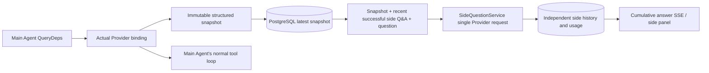

# ARTEX `/btw`

Ordinary chat, a task's MainAgent, and that task's own Workers support an independent side question. Type `/btw question` in the main input to submit it. An empty `/btw`, or the "Side question" button, opens the history. Desktop uses a resizable sidebar; mobile uses a Drawer.

The side answer is generated from the Agent context snapshot at submit time. It supports streaming, follow-up questions, stop, and clear. Closing the panel, refreshing the page, or dropping the SSE connection does not cancel the model request. Stop affects only the current side question. Clear cancels the side question and deletes its history, and keeps the main context snapshot.

## Implementation boundary

This stays on Go, norma v0.3.7, Next.js, and the existing Markdown / ResizablePanel / Drawer / AlertDialog components. Norma source was not modified, and no dependency was added for the side question. The Planner, Workers inherited from another task, and tool-style subtask upgrades are out of scope.

- `capture.go` marks a main-loop request only at `Options.Deps.CallModel / CallModelSync`. The Provider decorator sits inside the concrete model, after the outer routing pool has chosen, so it records the model that was actually selected. Compaction and summary requests do not overwrite the snapshot.
- A snapshot is published when a request starts, when a complete model reply arrives, and at the run's terminal state. A half-finished reply still being generated is not published. Tool calls stay paired through norma's `MessagesForAPI`. Tool results enter the snapshot on the next main model request or at the run's terminal state. A cancelled stream keeps the previous valid boundary.
- A snapshot keeps structured messages, the system prompt, tool definitions, and generation parameters through a JSON deep copy. Model inference does not hold the snapshot lock or a database transaction.
- `SideQuestionService` calls the concrete Provider. When needed it first writes a side-question summary. The final answer may shrink the context and retry once only when the first attempt exceeds the context limit and has not yet emitted text or a tool call. It does not create an agent session, and it is not wired into the tool executor, the main transcript, the activity stream, the task graph, or the task model-switch chain. The answer keeps tool definitions so existing structured tool context still works; summary requests do not offer tools. A newly returned tool call has no execution path.
- Each parent session has one running request, a single server process allows at most four, and one request times out after 120 seconds. The side question uses its own cancel context under the service lifetime.
- A side request keeps a model-config reference and a non-sensitive identity summary. Credentials are read from the existing config at request time. If the config is deleted, or identity fields such as model, protocol, or address change, the main Agent must run first to refresh the snapshot. Tests do not change the product's default model.

## Persistence and recovery

`db/schema.sql` creates `side_question_sessions` and `side_question_requests` automatically. The first stores the parent resource, the latest snapshot, the run number, the version, and the clear version. The second stores the question, the cumulative answer, status, model, snapshot time, usage, event sequence, and page sequence.

The parent session key is a conversation ID, or a task ID + exploration ID + intent ID. A Worker does not use a reusable execution-slot name.

Snapshots are merged per parent session and flushed every 250 ms. The database compares `(run_id, version)` so an older version cannot overwrite a newer one. The selected snapshot is saved again before a side question is submitted. After a successful save, the large in-memory snapshot is released; on failure the version waiting to be written is kept. Cumulative answer text is written at most every 250 ms as stream events arrive, and a terminal state is saved immediately, with a limited retry on a database error.

On startup, leftover `running` requests are marked `interrupted`. Partial answers and usage already stored are kept, and the request is not replayed automatically. The most recently saved context can be used for the next question. An old session with no snapshot must run the main Agent first; context is not rebuilt from UI activity records.

Clear increments the clear version and deletes requests. A conditional update stops a late callback from writing the data back. Physical deletion of a parent resource relies on foreign-key cascade. A Worker logical delete removes side-question data in the same transaction and rejects a later snapshot. Task archival first blocks new requests, waits for the main flow to stop, cancels the side question, and waits for it to be stored. The archive format is v3, and v1/v2 archives that have no side-question tables stay compatible.

History is stored in full. A sequence cursor returns at most 20 rows per page. A model request replays at most the latest 20 successful question-and-answer pairs verbatim, and the token budget also limits how much is replayed. Older pairs keep their own rolling summary. When the main context is over budget, only the older part of the side-question copy is summarized, and recent structured tool calls and results are kept. Summary, preparation progress, and usage all sit inside the side question's concurrency, cancellation, and 120-second timeout limits. See [Context budget and open-source references](CONTEXT_BUDGET.md).

## HTTP contract

The following paths are `{parent}` and reuse the existing authentication and resource checks:

- `/api/conversations/{id}`
- `/api/tasks/{id}/chat`
- `/api/tasks/{id}/intents/{iid}`

| Request | Response and behavior |
| --- | --- |
| `GET {parent}/side-questions?before={ordinal}` | `items` newest first, a separate `current` running state, `snapshot` metadata, and `next_cursor`. A cursor of 0 means the latest page / no next page |
| `POST {parent}/side-questions` | JSON `{ "question": "…", "client_request_id": "UUID" }`. A new request returns 202 and the request object. The same ID and question return the existing object with 200 |
| `DELETE {parent}/side-questions` | Cancel and clear side questions for the current parent session |
| `GET /api/side-questions/{requestID}/events` | `snapshot` SSE events. `id` is an increasing sequence, and `data` is the full cumulative request object. Clear sends `cleared` |
| `POST /api/side-questions/{requestID}/cancel` | Explicit cancel. The terminal state can be read from history or SSE |

Questions are limited to 4000 characters. No snapshot, a changed model config, a busy parent session, or an idempotency ID conflict returns 409. The global concurrency cap returns 429. Every SSE connection first sends the cumulative state and does not depend on text fragments the client already received. The frontend merges by request ID plus sequence, and drops old callbacks when the parent session changes or the history is cleared.

## Verification and references

Automated checks, real model use, and known limits are in [VALIDATION.md](VALIDATION.md).

The independent request follows [Grok CLI side-question.ts (pinned commit)](https://github.com/superagent-ai/grok-cli/blob/fb97af83f06dca873281d60168430f06c8de6324/src/utils/side-question.ts). Run isolation follows [OpenCode (pinned commit)](https://github.com/anomalyco/opencode/tree/b3f1a96c6dd7adeb28b36dd11add1998fc84d67b). ARTEX context uses norma's structured messages, and does not stitch text together from frontend logs.
