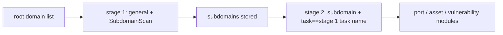

---

## name: scopesentry-mcp
description: Manage a security scanning platform through the ScopeSentry MCP (projects, tasks, templates, assets, nodes). Use when the user mentions ScopeSentry, MCP, API Key, scan tasks, or asset queries.

# ScopeSentry MCP guide

For users who **already have a ScopeSentry instance deployed**. Connect from Cursor (or another MCP client). Local source is not required.

## 1. Preparation

### 1.1 Confirm the service is reachable

- Default web UI: `http://<host>`
- MCP endpoint: `http://<host>/mcp` (if a reverse proxy or frontend proxy sits in front, use the real `/mcp` address)

### 1.2 Create an API key

1. Log in to the ScopeSentry web UI in a browser
2. Open the **API Key** page and create a key (or use the interface an administrator provides)
3. Save the returned `ssk_...` string (**shown only once**)

### 1.3 Configure Cursor MCP

Cursor → Settings → MCP → add a server:

```json
{
  "mcpServers": {
    "scopesentry": {
      "url": "http://<your-host>:8082/mcp",
      "headers": {
        "X-API-Key": "ssk_your_key"
      }
    }
  }
}
```

You can also use: `Authorization: Bearer ssk_your_key`

After saving, restart MCP or reload Cursor and confirm the tool list includes `list_projects`, `list_assets`, and the rest.

---

## 2. Tool list


| Tool                     | Purpose                                      |
| ---------------------- | -------------------------------------------- |
| `list_projects`        | Project tree grouped by tag (includes project IDs) |
| `list_projects_data`   | Paginated project list; can search by name   |
| `get_project`          | Project detail                               |
| `create_project`       | Create a project                             |
| `list_tasks`           | Scan task list                               |
| `get_task`             | Task detail                                  |
| `list_scan_templates`  | Scan template list                           |
| `get_scan_template`    | Template detail                              |
| `list_plugin_modules`  | Scan pipeline module names                   |
| `list_plugins`         | Available plugins (hash and default parameters) |
| `create_scan_template` | Create a scan template                       |
| `create_scan_task`     | Create a scan task                           |
| `list_assets`          | Query assets of each type (paginated list)   |
| `count_assets`         | Count assets (`/api/assets/common/total`)    |
| `get_asset_detail`     | Asset or vulnerability detail                |
| `add_asset_tag`        | Add a tag to an asset                        |
| `list_nodes`           | Scan node list                               |


Tool parameters follow the MCP tool description (schema). `list_assets` and `count_assets` share the same search and filter syntax. Read the `list_assets` description before querying assets.

When you need the total count, use `count_assets` (the web pagination total). Do not page through `list_assets` just to count.

---

## 3. Common workflows

### 3.1 Query assets by project

When the user or the context **already has a project**, pass `filter.project` first to narrow the set. Cross-project data makes the response slow. If there is no clear project, do not force a project filter.

1. `list_projects` or `list_projects_data` to get the target project's **ObjectID** (`id` / `children[].value`)
2. Pass `filter.project` to `list_assets` (**it must be the ID, not the project display name**)

```json
{
  "asset_type": "asset",
  "pageIndex": 1,
  "pageSize": 20,
  "search": "domain=^example.com",
  "filter": {
    "project": ["<project ObjectID>"]
  }
}
```

### 3.2 Create a scan task

1. `list_nodes` to get online node names
2. `list_scan_templates` or `create_scan_template` to get the template **ObjectID**
3. `create_scan_task`: `name` and `node` are required. `template` is the template ID (not the template name)

**Target source `targetSource` (same as the web UI):**

| targetSource | Meaning | Required parameters |
| --- | --- | --- |
| `general` | Type targets directly | `target` |
| `project` | Read targets from a project | `project` (array of project ObjectIDs) |
| `asset` | Search the web asset library | `search`; optional `project`, `filter`, `targetNumber` |
| `RootDomain` | Search the root-domain library | `search`; optional `project`, `filter`, `targetNumber` |
| `subdomain` | Search the subdomain library | `search`; optional `project`, `filter`, `targetNumber` |
| `UrlScan` | Search URL scan results | `search`; optional `project`, `filter`, `targetNumber` |
| `*Source` (for example `subdomainSource`) | Create from "selected/search" on an asset page | use `search` when `targetTp=search`; use `targetIds` when `targetTp=select` |

**Example — scan root domains directly:**

```json
{
  "name": "example-subdomain-collection",
  "node": ["node-1"],
  "template": "<template ObjectID>",
  "targetSource": "general",
  "target": "example.com\nfoo.com",
  "project": ["<project ObjectID>"]
}
```

**Example — continue from the subdomain library (filter by the previous task name):**

```json
{
  "name": "example-ports-and-vulns",
  "node": ["node-1"],
  "template": "<follow-up module template ObjectID>",
  "targetSource": "subdomain",
  "search": "task==\"example-subdomain-collection\"",
  "project": ["<project ObjectID>"]
}
```

### 3.3 Full collection for a root domain (two stages recommended)

When the input is a **root domain** and you want a **full collection**, scan twice. Do not run the whole pipeline in one task.

**Why:** Distributed tasks are dispatched **one target at a time**. When the target is a root domain, the node that receives it also runs every later module on the subdomains it finds, on that same node. Load skews, the scan is slow, and it fails more often.

**Practice:**

1. **Stage 1 — subdomain collection only**
   - `targetSource`: `general`
   - `target`: every root domain (one per line)
   - Template: enable only `SubdomainScan` and `SubdomainSecurity` (subdomain scan + subdomain takeover)
   - Wait for completion with `get_task`

2. **Stage 2 — the remaining modules**
   - `targetSource`: `subdomain`
   - `search`: `task=="<stage 1 task name>"` (exact task name)
   - Optional `project` to narrow the set
   - Template: port scan, asset mapping, vulnerability scan, and so on (SubdomainScan can be omitted)
   - Subdomains are dispatched as independent targets, so the nodes run in parallel and finish faster

The same result comes from the web UI: filter the "Subdomain" asset page by task name, then use "Create task from subdomains".



### 3.4 Create a scan template

1. `list_plugin_modules` → module name list
2. `list_plugins` (optional `module` filter) → each plugin's `hash` and default `parameter`
3. `create_scan_template`: `modules` maps "module → array of plugin hashes"

---

## 4. Asset queries (`list_assets` / `count_assets`)

`count_assets` uses the same `asset_type`, `search`, and `filter` as `list_assets` and returns `{ "total": N }`, matching the web endpoint `/api/assets/common/total`.

```json
{
  "asset_type": "subdomain",
  "search": "task==\"some-task-name\"",
  "filter": {"project": ["<project ObjectID>"]}
}
```

**Performance (`list_assets` / `count_assets`):** When a project is known, narrow with `filter.project` first. In `search`, prefer `==` (exact) or a `^` prefix on indexed fields (see [4.3](#43-search-expressions)). A broad `=` fuzzy query slows the response. Do not force a project filter when there is no project context.

Types that support `filter.project` are in the table in [4.4](#44-filter-exact-filtering).

### 4.1 Asset type `asset_type`

`asset`, `RootDomain`, `subdomain`, `app`, `mp`, `UrlScan`, `SensitiveResult`, `DirScanResult`, `crawler`, `vulnerability`, `PageMonitoring`, `IPAsset`, `SubdomainTakerResult`

Alias examples: `web`→asset, `vuln`→vulnerability, `ip`→IPAsset, `url`→UrlScan

### 4.2 Parameters


| Parameter                | Meaning                                      |
| ------------------------ | -------------------------------------------- |
| `pageIndex` / `pageSize` | Pagination, default 1 / 20                   |
| `search`                 | Search expression (next section)             |
| `filter`                 | Exact-filter JSON (next section)             |
| `sort`                   | Only UrlScan and DirScanResult sort by `length` |
| `sid`                    | SensitiveResult only: sensitive-rule name    |


`search` and `filter` **can be used together**.

### 4.3 search expressions

Custom DSL (**not SQL**):


| Operator | Meaning | Index | Example |
| ---- | ---- | ---- | --------------------------- |
| `=`  | Fuzzy match (regex) | Does not use the index | `domain=example`            |
| `==` | Exact match | **Uses the index** | `port==443`                 |
| `!=` | Exclude | — | `port!="80"`                |
| `&&` | And | — | `domain==example.com && port==443` |
| `||` | Or | — | `title=admin || body=login` |


**Index and operators:** Fields such as `domain`, `ip`, `port`, and `title` are indexed, but only **`==` exact match** or a **prefix match whose value starts with `^`** (for example `domain=^example.com`) can use the index. **`=` becomes a regex fuzzy match and cannot use the index**, so large data sets get slow.

**search fields common to every type:** `tag`, `task` (task name), `rootDomain`

**Do not put project in search** (it is ignored, or errors when combined with `&&`). Filter projects with `filter.project`.

**Common search fields by type:**


| asset_type           | Fields                                                                                  |
| -------------------- | ----------------------------------------------------------------------------------- |
| asset                | domain, ip, port, service, app, title, statuscode, icon, banner, type, body, header |
| RootDomain           | domain, icp, company                                                                |
| subdomain            | domain, ip, type, value                                                             |
| app                  | name, icp, company, category, description, url, apk                                 |
| mp                   | name, icp, company, category, description, url                                      |
| UrlScan              | url, input, source, resultId, type                                                  |
| SensitiveResult      | url, sname, body, info, md5                                                         |
| DirScanResult        | url, statuscode, redirect, length                                                   |
| vulnerability        | url, vulname, matched, request, response, level                                     |
| crawler              | url, method, body, resultId                                                         |
| PageMonitoring       | url, hash, diff, response                                                           |
| IPAsset              | ip, domain, port, service, webServer, app                                           |
| SubdomainTakerResult | domain, value, type, response                                                       |


**search examples:**

- `domain==www.example.com && port==443` (exact, uses the index)
- `domain=^example.com` (prefix, uses the index)
- `ip==192.168.1.1`
- `task=="some-task-name"`
- `level==high` (vulnerability)
- `statuscode==200` (DirScanResult)

Use `=` only when you need a fuzzy contains, for example `title=admin` (does not use the index; narrow with a project or similar condition).

### 4.4 filter exact filtering

JSON object: multiple values of the same key are **OR**; different keys are **AND**.

**Prefer `project` when a project is known:** If the user or the context already names a project, and the asset_type supports `project`, include it to narrow the set. Do not force it when there is no project.


| filter key   | Meaning | Value |
| ------------ | -------- | -------------------------------------------------------- |
| `project`    | Owning project | **ObjectID**, from `list_projects` / `list_projects_data` |
| `task`       | Source task | **Task name**, the `name` from `list_tasks` |
| `port`       | Port | for example `"443"` |
| `service`    | Service/protocol | for example `"https"` |
| `app`        | Application fingerprint | for example `"Nginx"` |
| `icon`       | Icon hash | |
| `statuscode` | HTTP status code | mainly asset |
| `status`     | Status | UrlScan/DirScan HTTP code; vulnerability / sensitive-info handling status |
| `level`      | Vulnerability severity | critical / high / medium / low / info |
| `type`       | Type | for example subdomain record types A, CNAME |
| `color`      | Sensitive-rule color | SensitiveResult |
| `sname`      | Sensitive-rule name | SensitiveResult |
| `tags`       | Tags | |


**filter keys available per type:**


| asset_type                            | filter key                                                      |
| ------------------------------------- | --------------------------------------------------------------- |
| asset                                 | project, port, service, app, icon, statuscode, type, task, tags |
| RootDomain                            | project, tags                                                   |
| subdomain                             | project, type, task, tags                                       |
| app / mp                              | project, tags                                                   |
| UrlScan                               | status, tags                                                    |
| DirScanResult                         | status, tags                                                    |
| SensitiveResult                       | status, color, sname, tags                                      |
| crawler                               | project, task, tags                                             |
| vulnerability                         | project, level, status, task, tags                              |
| PageMonitoring / SubdomainTakerResult | tags                                                            |
| IPAsset                               | project, port, service, app                                     |


**filter example:**

```json
{"project": ["<project ObjectID>"], "port": ["443"]}
```

**Combined query example:**

```json
{
  "asset_type": "asset",
  "search": "domain=^baidu && port==443",
  "filter": {"project": ["<project ObjectID>"]},
  "pageIndex": 1,
  "pageSize": 10
}
```

**Notes:**

- When a project is known, prefer `filter.project` (if that type supports it). Do not force it without a project context
- Do not put the project display name in `filter.project`
- Use `==` for known values and `^` for prefixes. Do not abuse `=` fuzzy match on large tables
- UrlScan HTTP status uses `filter.status`. DirScanResult can use `statuscode==200` in search
- SensitiveResult by rule name: `sname=rule-name` in `search`, or `filter.sname`

### 4.5 sort

Only **UrlScan** and **DirScanResult** support it:

```json
{"length": "ascending"}
```

Other types ignore `sort` and sort by time by default.

---

## 5. Scan template module names

`TargetHandler`, `SubdomainScan`, `SubdomainSecurity`, `PortScanPreparation`, `PortScan`, `PortFingerprint`, `AssetMapping`, `AssetHandle`, `URLScan`, `WebCrawler`, `URLSecurity`, `DirScan`, `VulnerabilityScan`, `PassiveScan`

---

## 6. Troubleshooting


| Symptom | What to do |
| --------- | -------------------------------------------------- |
| MCP has no tools | Check the URL, the API key, and whether ScopeSentry is running |
| 401 / 403 | Create a new API key or replace the current one |
| Assets not found | Confirm `filter.project` is an ObjectID. Do not put project in search |
| Template or task creation failed | `template` must be a template ObjectID. `node` must be an online node name |
| Query is slow or stuck | Add `filter.project` when a project is known. On indexed search fields use `==` or a `^` prefix instead of `=`. Lower `pageSize` |


---
